README
================

# 10.3.3 Exercises

## 1. Distribution of x, y, and z

``` r
library(ggplot2)
```

    ## Warning: package 'ggplot2' was built under R version 4.3.3

``` r
ggplot(diamonds, aes(x = x)) +
  geom_histogram(binwidth = 0.1)
```

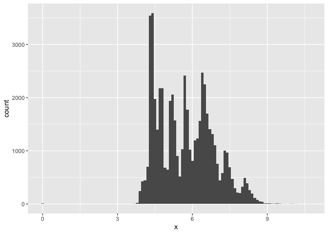<!-- -->

``` r
ggplot(diamonds, aes(x = y)) +
  geom_histogram(binwidth = 0.1)
```

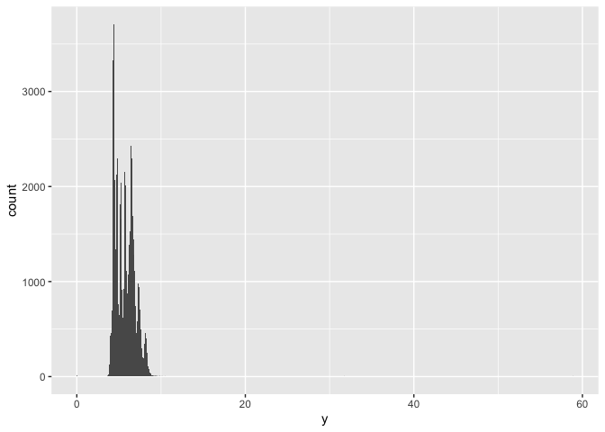<!-- -->

``` r
ggplot(diamonds, aes(x = z)) +
  geom_histogram(binwidth = 0.1)
```

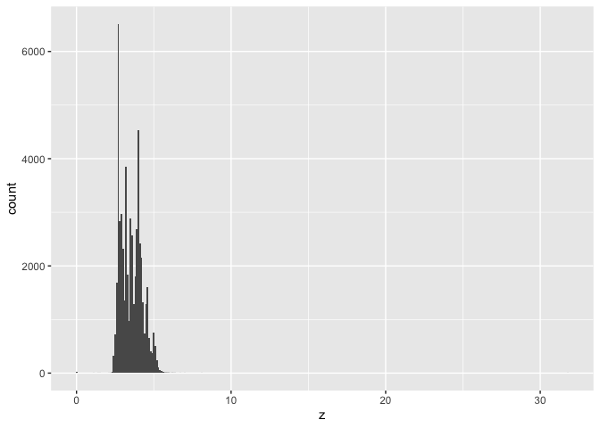<!-- -->

The distributions of x and y are fairly similar, while z is generally much smaller. This makes sense because x and y represent the length and width of the diamond, while z represents its depth. Most diamonds are concentrated within a fairly narrow range, but there are also some unusual extreme values, especially for y and z, that may represent data errors or unusual observations.

``` r
summary(diamonds[c("x", "y", "z")])
```

    ##        x                y                z         
    ##  Min.   : 0.000   Min.   : 0.000   Min.   : 0.000  
    ##  1st Qu.: 4.710   1st Qu.: 4.720   1st Qu.: 2.910  
    ##  Median : 5.700   Median : 5.710   Median : 3.530  
    ##  Mean   : 5.731   Mean   : 5.735   Mean   : 3.539  
    ##  3rd Qu.: 6.540   3rd Qu.: 6.540   3rd Qu.: 4.040  
    ##  Max.   :10.740   Max.   :58.900   Max.   :31.800

## 2. Distribution of price

``` r
ggplot(diamonds, aes(x = price)) +
  geom_histogram(binwidth = 1000)
```

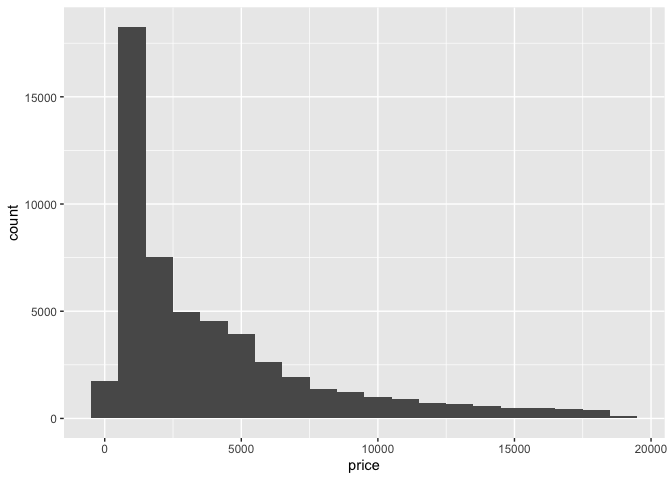<!-- -->

``` r
ggplot(diamonds, aes(x = price)) +
  geom_histogram(binwidth = 100)
```

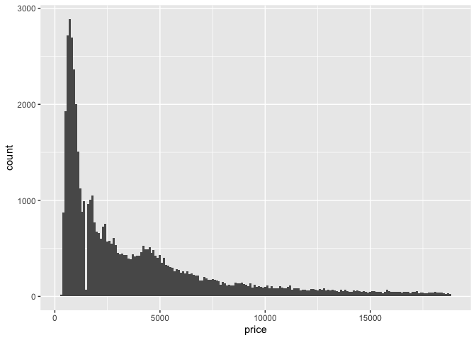<!-- -->

``` r
ggplot(diamonds, aes(x = price)) +
  geom_histogram(binwidth = 10)
```

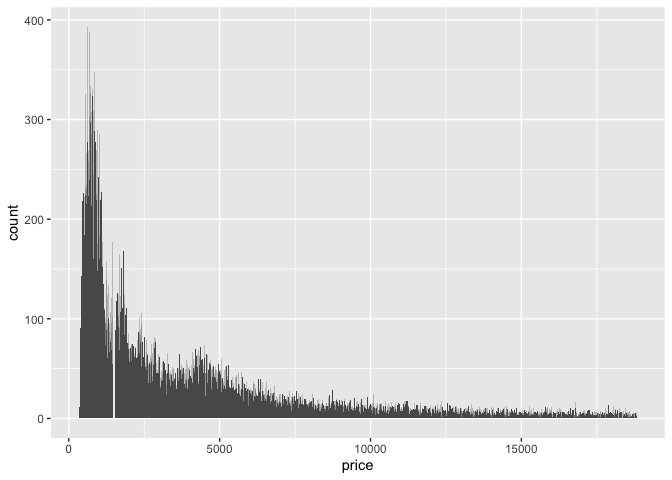<!-- --> The distribution of price is strongly right-skewed. Most diamonds are concentrated at lower prices, with fewer diamonds as price increases. Using a smaller binwidth also reveals many sharp spikes in the distribution that are hidden when using wider bins. This suggests that certain price points occur much more frequently than nearby prices, which was not obvious from the wider histograms.

## 3. Diamonds at 0.99 and 1.00 carat

``` r
sum(diamonds$carat == 0.99)
```

    ## [1] 23

``` r
sum(diamonds$carat == 1.00)
```

    ## [1] 1558

There are only 23 diamonds that are 0.99 carat, compared with 1,558 diamonds that are exactly 1.00 carat. The large difference is likely because 1.00 carat is a psychologically important cutoff for buyers. Diamonds that are close to one carat may be cut to reach the 1.00-carat mark because they can often be sold for a higher price once they reach that threshold. \## 4. coord_cartesian() vs. xlim() and ylim()

``` r
# Original histogram
ggplot(diamonds, aes(x = price)) +
  geom_histogram(binwidth = 500)
```

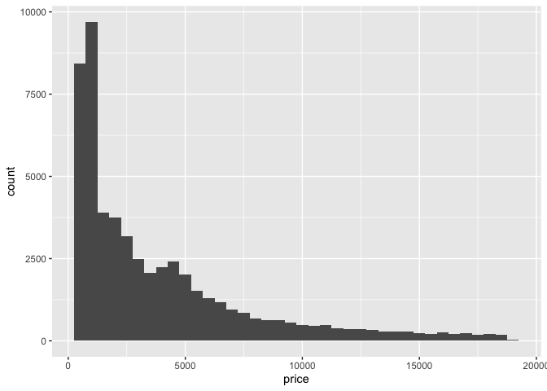<!-- -->

``` r
# Zoom using coord_cartesian()
ggplot(diamonds, aes(x = price)) +
  geom_histogram(binwidth = 500) +
  coord_cartesian(xlim = c(0, 5000))
```

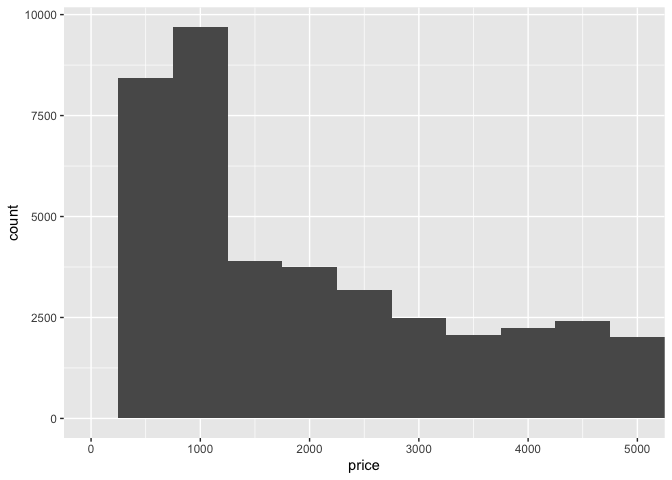<!-- -->

``` r
# Zoom using xlim()
ggplot(diamonds, aes(x = price)) +
  geom_histogram(binwidth = 500) +
  xlim(0, 5000)
```

    ## Warning: Removed 14714 rows containing non-finite outside the scale range
    ## (`stat_bin()`).

    ## Warning: Removed 2 rows containing missing values or values outside the scale range
    ## (`geom_bar()`).

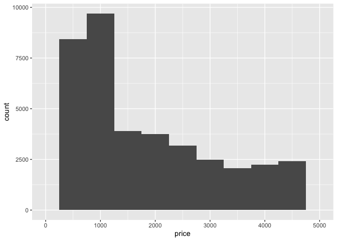<!-- -->

``` r
# Leave binwidth unset
ggplot(diamonds, aes(x = price)) +
  geom_histogram() +
  coord_cartesian(xlim = c(0, 5000))
```

    ## `stat_bin()` using `bins = 30`. Pick better value with `binwidth`.

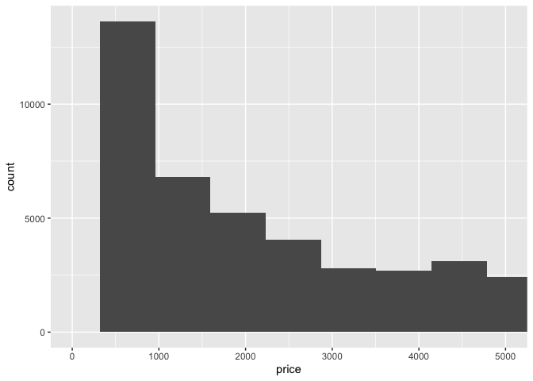<!-- -->

``` r
ggplot(diamonds, aes(x = price)) +
  geom_histogram() +
  xlim(0, 5000)
```

    ## `stat_bin()` using `bins = 30`. Pick better value with `binwidth`.

    ## Warning: Removed 14714 rows containing non-finite outside the scale range
    ## (`stat_bin()`).

    ## Warning: Removed 2 rows containing missing values or values outside the scale range
    ## (`geom_bar()`).

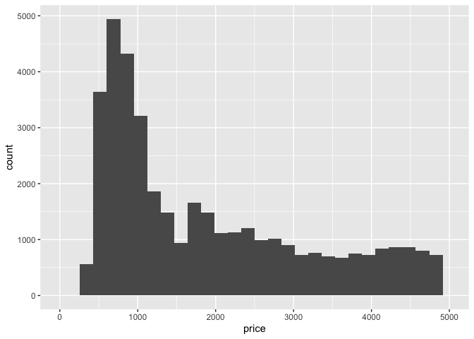<!-- -->

``` r
# Zoom so only part of a bar is visible
ggplot(diamonds, aes(x = price)) +
  geom_histogram(binwidth = 500) +
  coord_cartesian(xlim = c(750, 4750))
```

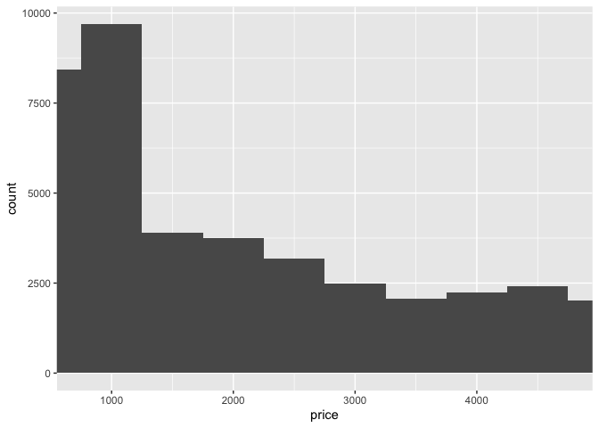<!-- -->

``` r
ggplot(diamonds, aes(x = price)) +
  geom_histogram(binwidth = 500) +
  xlim(750, 4750)
```

    ## Warning: Removed 24176 rows containing non-finite outside the scale range
    ## (`stat_bin()`).

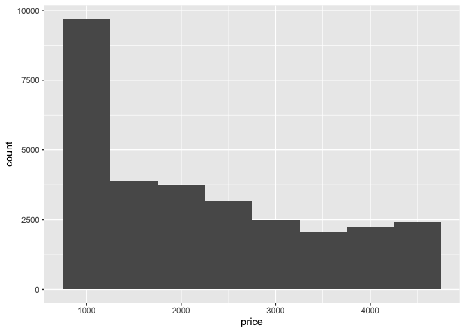<!-- --> `coord_cartesian()` only zooms in on the plot and does not remove any observations, so the histogram is calculated using the full dataset. In contrast, `xlim()` or `ylim()` remove observations outside the specified limits before the histogram is calculated, which can change the bars and produces a warning about removed rows. If `binwidth` is left unset, the difference is even more noticeable because the automatic bin widths can change when data are removed. If the zoom cuts through the middle of a bar, `coord_cartesian()` simply shows part of that bar, while `xlim()` can change or remove the bar because some of the underlying observations are excluded. \# 10.4.1 Exercises

## 1. Missing values in histograms and bar charts

``` r
library(nycflights13)
library(dplyr)
```

    ## 
    ## Attaching package: 'dplyr'

    ## The following objects are masked from 'package:stats':
    ## 
    ##     filter, lag

    ## The following objects are masked from 'package:base':
    ## 
    ##     intersect, setdiff, setequal, union

``` r
# Histogram with missing values
ggplot(flights, aes(x = dep_delay)) +
  geom_histogram(binwidth = 10)
```

    ## Warning: Removed 8255 rows containing non-finite outside the scale range
    ## (`stat_bin()`).

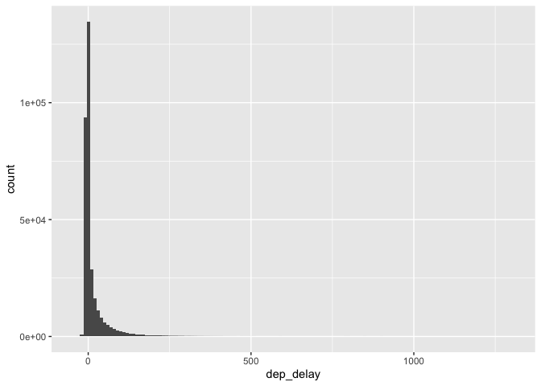<!-- -->

``` r
# Turn dep_delay into categories, keeping missing values
flights |>
  mutate(delay_group = cut(dep_delay, breaks = c(-Inf, 0, 15, Inf))) |>
  ggplot(aes(x = delay_group)) +
  geom_bar()
```

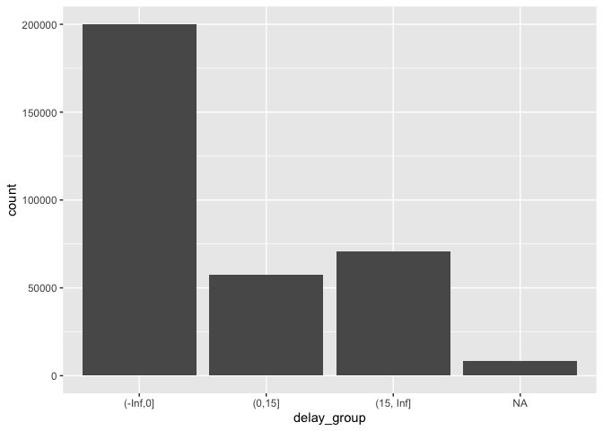<!-- --> Missing values in a histogram are removed because a histogram requires a numeric value in order to place each observation into a bin. In a bar chart, missing values can be treated as their own category and shown as an NA bar. The difference occurs because histograms summarize a continuous numerical variable, while bar charts count observations within discrete categories. \## 2. na.rm = TRUE in mean() and sum()

``` r
x <- c(1, 2, 3, NA)

mean(x)
```

    ## [1] NA

``` r
mean(x, na.rm = TRUE)
```

    ## [1] 2

``` r
sum(x)
```

    ## [1] NA

``` r
sum(x, na.rm = TRUE)
```

    ## [1] 6

`na.rm = TRUE` tells R to remove or ignore missing values before performing the calculation. Without it, `mean()` and `sum()` return `NA` when the data contain a missing value. In this example, ignoring the missing value gives a mean of 2 and a sum of 6. \## 3. Scheduled departure time and cancelled flights

``` r
flights2 <- flights |>
  mutate(
    cancelled = is.na(dep_time),
    sched_hour = sched_dep_time %/% 100,
    sched_min = sched_dep_time %% 100,
    sched_dep_time = sched_hour + sched_min / 60
  )

ggplot(flights2, aes(x = sched_dep_time, color = cancelled)) +
  geom_freqpoly(binwidth = 1/4) +
  facet_wrap(~ cancelled, scales = "free_y")
```

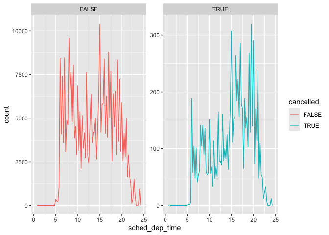<!-- --> The frequency plots show that there are many more non-cancelled flights than cancelled flights. Using the default fixed scales makes the cancelled-flight pattern difficult to see because its counts are much smaller. Setting `scales = "free_y"` allows each facet to use its own y-axis scale, making the patterns in both cancelled and non-cancelled flights much easier to compare. The cancelled flights also appear to vary by scheduled departure time rather than being evenly distributed throughout the day.

``` r
ggplot(flights2, aes(x = sched_dep_time, color = cancelled)) +
  geom_freqpoly(binwidth = 1/4) +
  facet_wrap(~ cancelled, scales = "fixed")
```

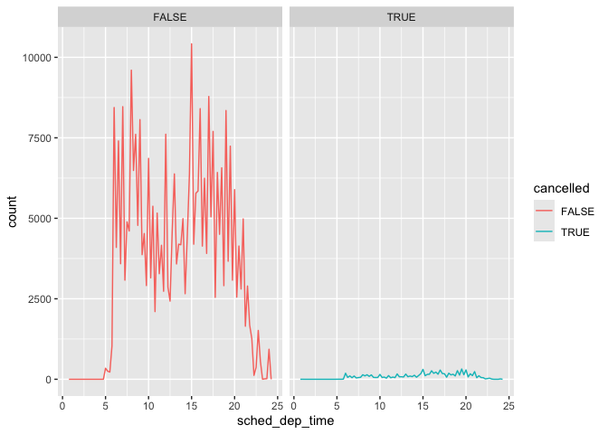<!-- -->

``` r
ggplot(flights2, aes(x = sched_dep_time, color = cancelled)) +
  geom_freqpoly(binwidth = 1/4) +
  facet_wrap(~ cancelled, scales = "free")
```

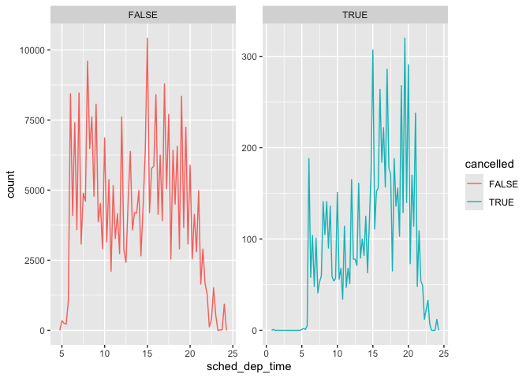<!-- -->
